<div align="center">


# CanvaRoom

### The whiteboard where everyone draws, talks, and follows along — live.

One link. One board. Your whole class or team on the same page, with no lag.

<a href="https://canva-room-blush.vercel.app"></a>
<a href="https://canva-room-blush.vercel.app/?mode=signup"></a>
<a href="https://canva-room-blush.vercel.app/contact"></a>

<br /><br />

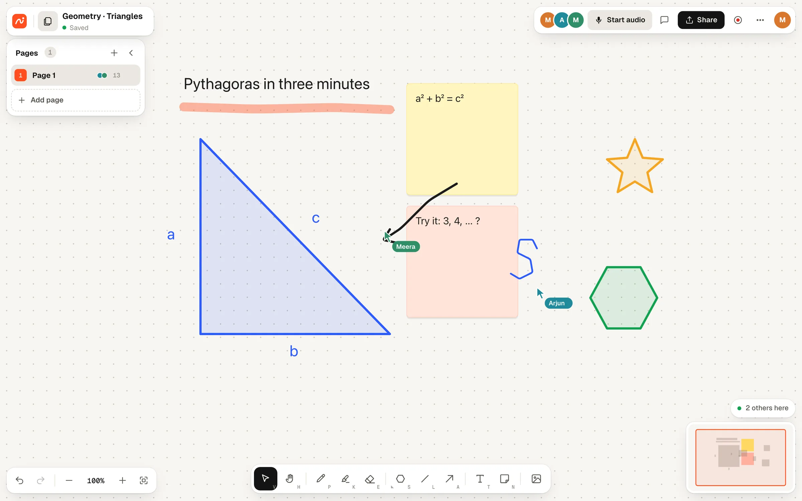

<sub>A real lesson on a real board: the teacher writes, Arjun answers, Meera points — all at the same moment.</sub>

</div>

---

## 📖 The story

> **Tuesday, 7:00 pm.** A tutor opens a video call, shares a slow whiteboard in another tab, and pastes links into a third app for chat. They start drawing a triangle. Their students see it two seconds later, in pieces. Someone asks _"where are you writing?"_ Someone else is still scrolling around the board looking for it.

That evening is the reason CanvaRoom exists. Three apps for one lesson, ink that lags, and a board only one person can really use.

**CanvaRoom puts it all in one room:**

- ✏️ **Ink arrives while you draw**, not after you lift the pen.
- 🎯 **Everyone's screen follows the writer**, so nobody gets lost on a big board.
- 🎙️ **Voice and chat are built in**, so there's no second app to juggle.
- 📲 **Students join from a link or a QR code**, with no account and nothing to install.

<p align="center">
  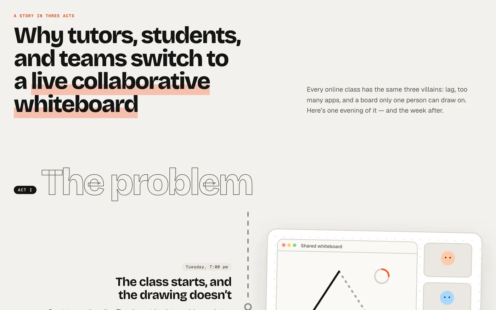
</p>

---

## ✨ See it in action

<div align="center">
  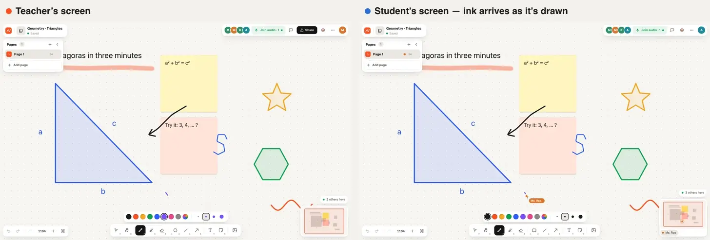
  <br />
  <sub><b>Left:</b> the teacher's screen. <b>Right:</b> a student's screen, following along. The stroke appears as it's being drawn.</sub>
</div>

---

## 🧭 A tour of the board

### Live ink, with no lag

Every stroke, shape, move and keystroke streams to everyone as it happens. Cursors glide with names attached, so you always know who's pointing where. Erasing is live too.

### Follow the writer

When someone starts writing, everyone else's screen glides over to it. If two people write at once, focus stays with whoever started first. And if you'd rather look around on your own, scroll away or press **Stop**. A little **locator** in the corner shows the whole page and pulses wherever someone is writing; tap it to jump there.

<table>
  <tr>
    <td width="50%">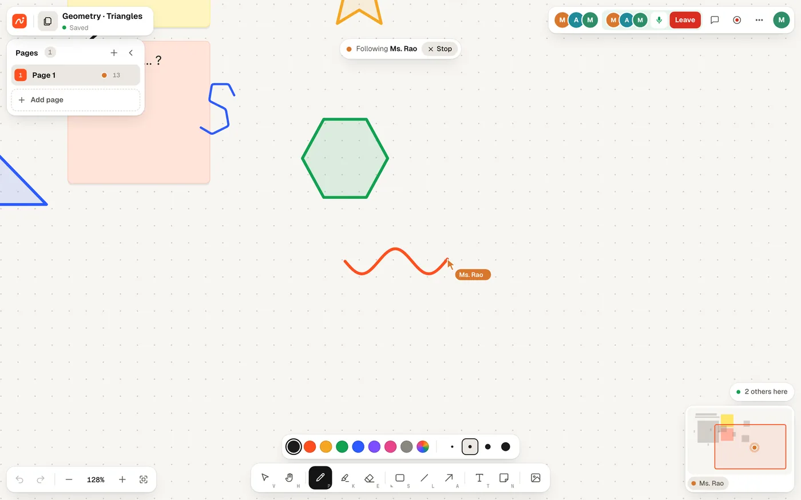</td>
    <td width="50%">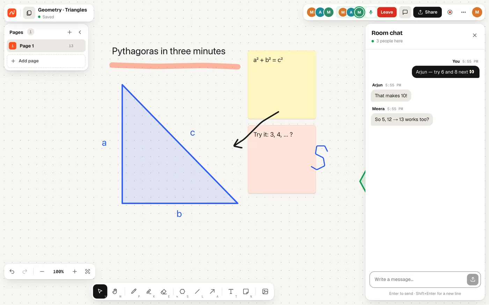</td>
  </tr>
  <tr>
    <td align="center"><sub><b>Following Ms. Rao</b> — the screen moves itself</sub></td>
    <td align="center"><sub><b>Voice and chat</b> — right next to the board</sub></td>
  </tr>
</table>

### Voice and chat, built in

Start audio from the top bar and everyone on the board can join with one click. Speaking indicators show who's talking, and **M** mutes you. The room chat sits beside the board, with unread badges and history.

### Shapes, notes and templates

Pen, marker, eraser, text and sticky notes, plus twelve shapes behind one button: rectangle, ellipse, diamond, triangle, right triangle, parallelogram, trapezoid, pentagon, hexagon, star, cylinder and speech bubble. Lines and arrows too. Start from a blank canvas or a **brainstorm, flowchart, kanban or retrospective** template.

<table>
  <tr>
    <td width="50%">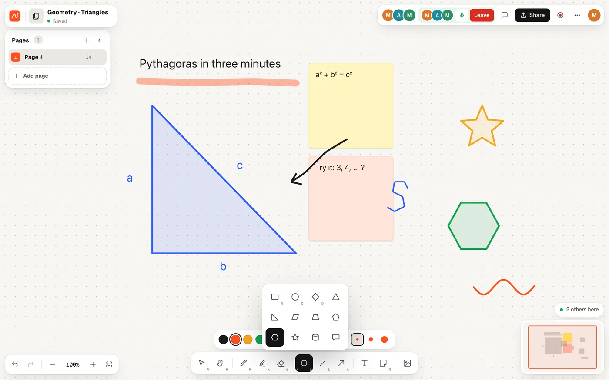</td>
    <td width="50%">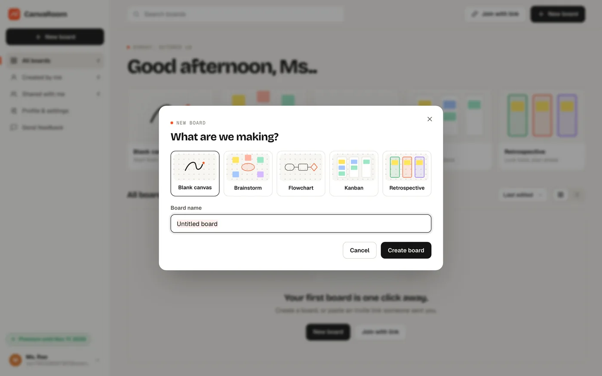</td>
  </tr>
  <tr>
    <td align="center"><sub>Twelve shapes, one button — press <b>S</b></sub></td>
    <td align="center"><sub>Start blank or from a template</sub></td>
  </tr>
</table>

### Pages and zoom

Give each topic its own page and see who's on which page in the side panel. Zoom from 10% to 800% to get a bird's-eye view or fine detail, and jump anywhere with the minimap.

### Invite with a link or a QR code

Share a link, or put the QR code on a slide and let the class scan it. Guests join with just a name. Switch people to view-only, or pause editing for everyone when you need the room's attention.

### Record the lesson

Hit record, choose **720p, 1080p, 1440p or 4K**, and CanvaRoom captures the board exactly as you see it, along with your voice and the call. When you stop, the video downloads straight to your computer. Nothing is uploaded.

<table>
  <tr>
    <td width="50%">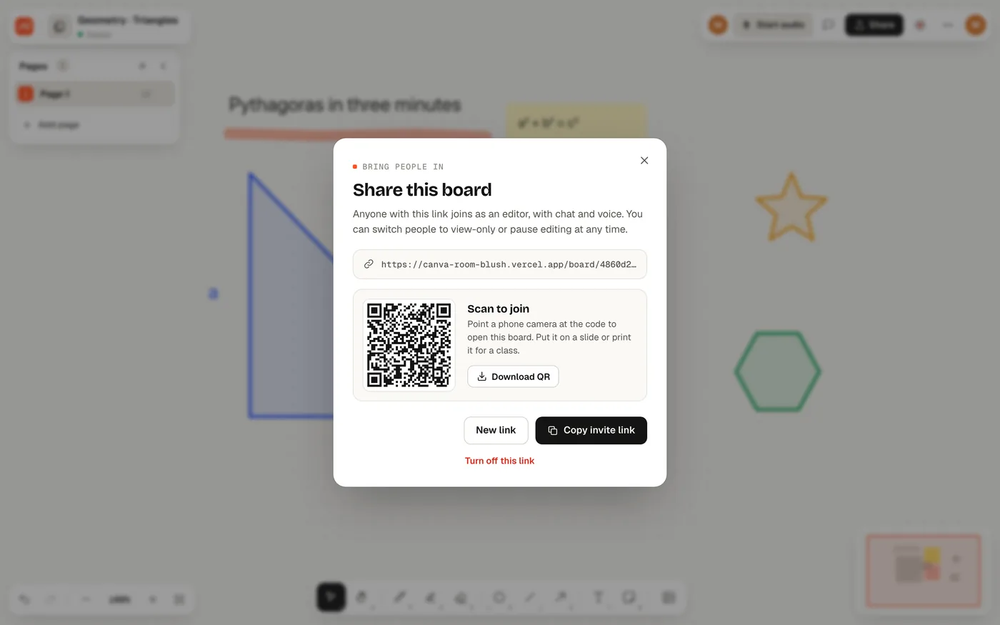</td>
    <td width="50%">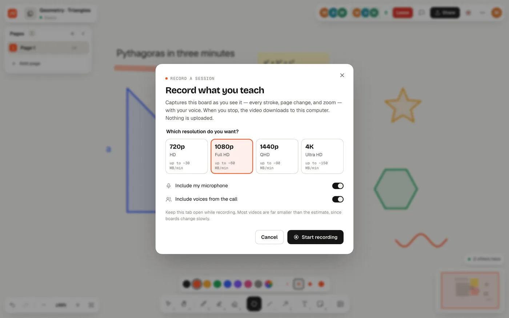</td>
  </tr>
  <tr>
    <td align="center"><sub>Scan to join — no account needed</sub></td>
    <td align="center"><sub>Pick a resolution, up to 4K</sub></td>
  </tr>
</table>

### Export and version history

Export any page as a **PNG** for the group chat, an **SVG** for slides, or a **PDF** for homework. Saved versions let you look back at, or restore, an earlier state of the board.

### Dark mode and phones

Easy on the eyes at night, and fully usable on a phone, whether you're joining a class or drawing on the go.

<details>
<summary><b>📱 See CanvaRoom on a phone and in dark mode</b></summary>
<br />
<table>
  <tr>
    <td width="33%">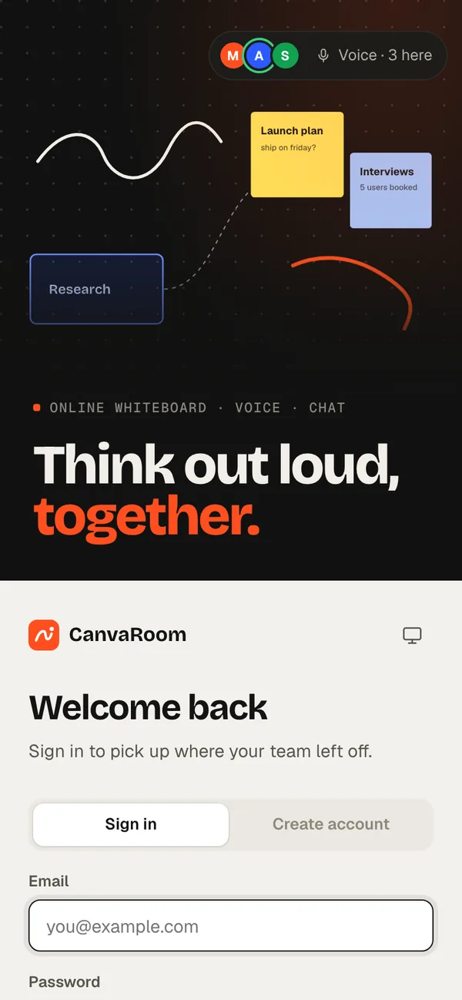</td>
    <td width="33%">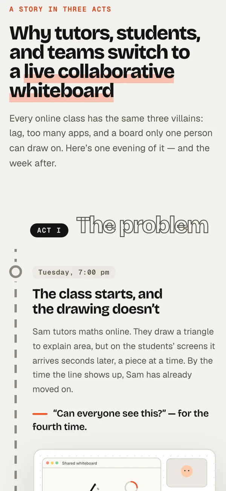</td>
    <td width="33%">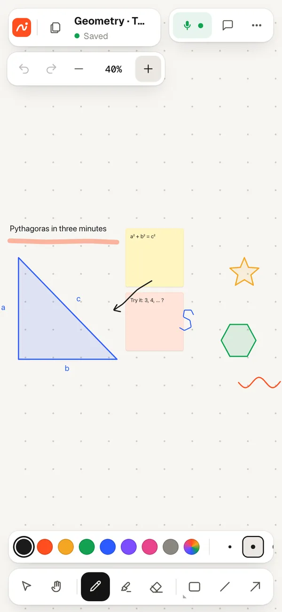</td>
  </tr>
</table>
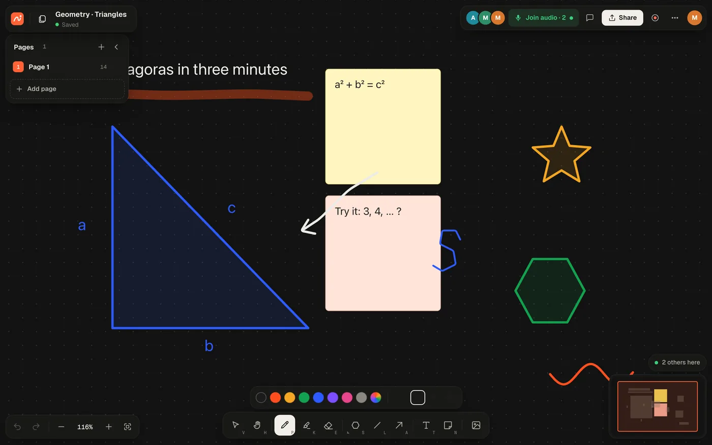
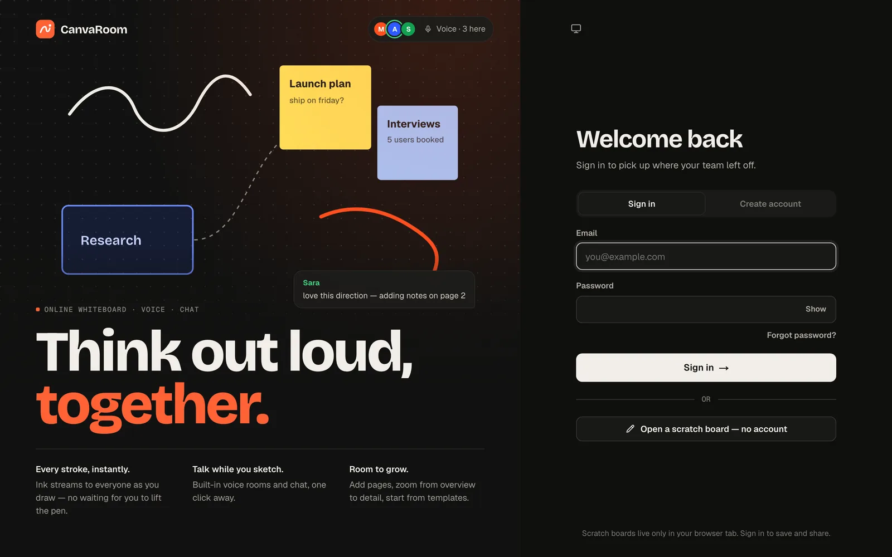
</details>

<details>
<summary><b>👋 What a new board looks like</b></summary>
<br />
A fresh page shows a quiet guide to every tool and shortcut. It fades away the moment you start drawing.
<br /><br />
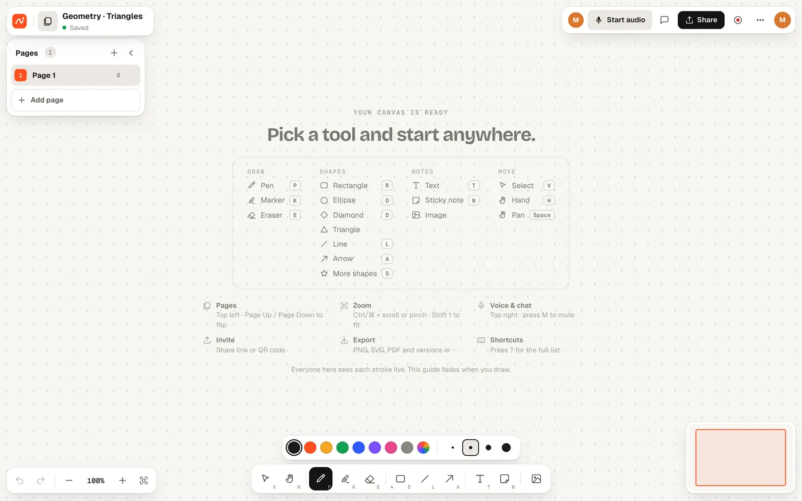
</details>

---

## 🎓 Who it's for

<table>
  <tr>
    <td align="center" width="20%"><h3>🧑‍🏫</h3><b>Tutors</b><br /><sub>Teach one-to-one or small batches, and record the session for later.</sub></td>
    <td align="center" width="20%"><h3>🏫</h3><b>Classrooms</b><br /><sub>Put the QR code on screen and everyone's in within seconds.</sub></td>
    <td align="center" width="20%"><h3>📚</h3><b>Study groups</b><br /><sub>Solve problems together and talk them through on voice.</sub></td>
    <td align="center" width="20%"><h3>💼</h3><b>Teams</b><br /><sub>Brainstorm, map flows and run retros on one shared board.</sub></td>
    <td align="center" width="20%"><h3>🧩</h3><b>Workshops</b><br /><sub>Let a room full of people write at once without losing the thread.</sub></td>
  </tr>
</table>

---

## 🚀 How it works, in 3 steps

<table>
  <tr>
    <td align="center" width="33%"><h2>1</h2><b>Open a board</b><br /><sub>Sign up and pick a template, or open a scratch board with no account at all.</sub></td>
    <td align="center" width="33%"><h2>2</h2><b>Bring people in</b><br /><sub>Share the link or show the QR code. Guests join with just their name.</sub></td>
    <td align="center" width="33%"><h2>3</h2><b>Draw and talk together</b><br /><sub>Start audio, write, and watch everyone's screens follow along.</sub></td>
  </tr>
</table>

---

## 💳 Plans

|                                 |    **Free trial**    |    **Free**     | **Premium** |
| ------------------------------- | :------------------: | :-------------: | :---------: |
| When                            | 30 min of active use | After the trial |   Monthly   |
| Boards                          |          2           |        1        |  Unlimited  |
| People on a board               |       You + 2        |    Just you     |  Unlimited  |
| Live drawing, voice and chat    |          ✅          |       ✅        |     ✅      |
| Pages, templates, zoom, history |          ✅          |       ✅        |     ✅      |
| Follow-the-writer               |          ✅          |        —        |     ✅      |
| Export to PNG, SVG and PDF      |          —           |        —        |     ✅      |
| Images on the board             |          —           |        —        |     ✅      |
| Session recording, up to 4K     |          —           |        —        |     ✅      |

**Premium is ₹499 a month in India, or $11.99 a month everywhere else** (launch offer, normally $15.99). Each payment unlocks a month, and nothing renews on its own.

The trial clock only runs while CanvaRoom is open in front of you; it pauses when you switch away. Scratch boards, used without an account, are always free.

<details>
<summary><b>See the plans and what Premium adds</b></summary>
<br />
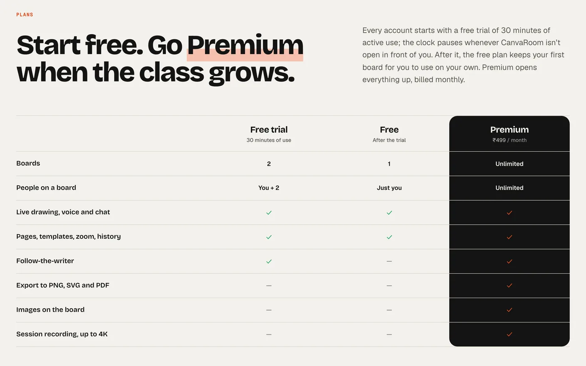
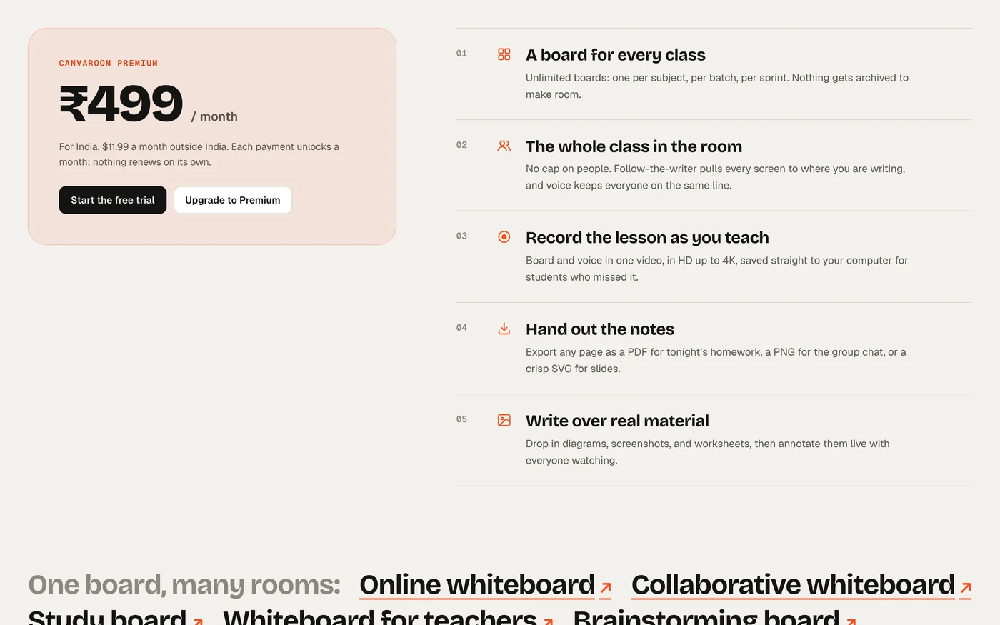
</details>

---

## ❓ FAQ

<details>
<summary><b>Do the people I invite need an account?</b></summary>
<br />
No. Share an invite link or QR code and they join as a guest with just a name. They only need an account to create boards of their own.
</details>

<details>
<summary><b>Is drawing really live?</b></summary>
<br />
Yes. Strokes stream to everyone while you draw, typically in under a tenth of a second, instead of appearing only when you lift the pen.
</details>

<details>
<summary><b>Do we need a separate meeting app?</b></summary>
<br />
No. Every board has its own voice room and chat, one click away in the top bar.
</details>

<details>
<summary><b>Can I try it without signing up?</b></summary>
<br />
Yes. Open a scratch board from the home page. It lives only in your browser tab; create an account when you want to save and share it.
</details>

<details>
<summary><b>Where do my recordings go?</b></summary>
<br />
Straight to your own computer as a video file. Recordings are never uploaded or stored by CanvaRoom.
</details>

<details>
<summary><b>Do I need to install anything?</b></summary>
<br />
No. CanvaRoom runs in any modern browser, on a laptop, tablet or phone.
</details>

---

## 💬 Contact and feedback

We read every message.

- ✉️ **Email:** [ivyan26733@gmail.com](mailto:ivyan26733@gmail.com)
- 📬 **Contact page:** [canva-room-blush.vercel.app/contact](https://canva-room-blush.vercel.app/contact)
- 💡 **Feedback:** use **Send feedback** in the app's sidebar or footer. It reaches us directly.

---

<div align="center">

<sub><b>Built with</b> Next.js · real-time WebSockets · WebRTC voice via Cloudflare · Postgres</sub>

</div>

<details>
<summary><b>🛠️ For developers</b></summary>

<br />

Requirements: Node.js 20.9+ and npm.

```sh
cp .env.example .env
npm install
npm run dev
```

Open [http://localhost:3000](http://localhost:3000). `npm run dev` starts the web app and the API (port 4000). Without a database configured, the API keeps boards in memory and saves them to `apps/server/data/`, so no extra setup is needed to try it locally.

Before sending changes:

```sh
npm run typecheck
npm run lint
npm run build
npm run format:check
```

`.env.example` lists every optional setting.

</details>
